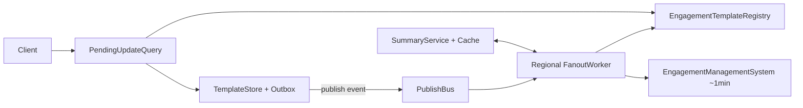

# Design: Pending Template Updates for Engagement Files

**Staff Java Developer take-home — Caseware.** Markdown design document (Part 1).

## 1. Architecture and data ownership

**Control plane (global, template content is not firm-specific):**
- `TemplateStore` (shared DB): immutable template versions, metadata (market, parents, withdrawn, publishedAt).
- `PublishBus`: transactional outbox on `TemplateStore` → regional queues (at-least-once).
- `SummaryService`: converts a JSON diff into a human-readable summary, cached by `(template, from, to, locale, promptVersion)`.

**Data plane (per region: US / EU / CA):**
- `EngagementTemplateRegistry` (sidecar, firm-scoped): `engagementId, firmId, market, templateId, baseVersion, basePublishedAt, pendingVersion, pendingUpdatedAt, declinedVersions, region, updatedAt`.
- `FanoutWorker` (regional): consumes publish events, updates registry pending state.
- `EngagementManagementSystem` (existing): loads engagements, handles create / accept / decline (~1 min/engagement).

**Query path (no engagement loading):** UI asks `PendingUpdateQuery(baseVersion vs. latest non-withdrawn version for the firm's market)` → registry + template store. Indicator is derived, so it is correct within seconds of a publish even before fan-out finishes.

**Ownership table**

| Data | Owner | Residency |
|---|---|---|
| Template versions & content | Content teams (global) | Global (not confidential) |
| Engagement content | Firm | Firm's region |
| Engagement template metadata (ids/versions) | Platform | Firm's region (sidecar) |
| Pending summaries | Platform | Global cache, no firm data |
| Audit trail of summaries | Platform | Region of requesting firm |

## 2. Correctness and production evolution

**Version model.** Versions form a DAG: each has `market`, `parentVersions[]`, `withdrawn`, `publishedAt`. An engagement is eligible for a candidate iff: same template + market applies to the firm, candidate is not withdrawn, candidate ≠ base, and candidate ∉ `declinedVersions`.

**Offer selection (accumulation).** When several versions accumulate, offer the **latest non-withdrawn candidate** for the firm's market branch, with the summary diff = `base → candidate`. Declining records the **exact version id**, not its changes: a later v7 that contains v5's changes is still offered because v7 ≠ v5. This is the intended reading of "declined v5 may later be offered v7".

**Withdrawn.** If an offered version is withdrawn, clear pending **only for engagements whose `pendingVersion` equals that exact version**, then recompute against the next eligible version (fan-out with `candidate = null`). A withdrawal must never clear a different, newer pending offer.

**Event ordering.** Publish events are at-least-once and may arrive out of order. The registry keeps `basePublishedAt` and `pendingUpdatedAt`; a worker ignores any event older than the base it applies to, and refuses to downgrade a newer pending candidate with an older publish. Withdrawals are also timestamp-guarded. Production would use a monotonic per-template sequence instead of wall-clock time.

**Evolution without downtime.** Add hooks on template publish (outbox) and on engagement create/accept/decline (registry write) — both additive. Backfill handles pre-existing engagements. No maintenance window required.

**Backfill.** Legacy engagements have no registry row. Preferred path: extract the stored template id/version header from the engagement persistence layer without full rehydration (hours, not days). If the header is not readable, fall back to a throttled backfiller that loads each engagement (~1 min) at the downstream capacity budget (≈11 days at 50 concurrent). Until indexed, an engagement reports `status = unknown` (not "no update") and is prioritised by last activity; rollout is behind a per-firm feature flag.

## 3. Scale, cost and operational characteristics

Inputs: 4,000 firms, 800,000 active engagements, 40 products, ~1 publish/product/week, engagement counts skewed (median firm ~40, largest ~40,000).

- **Indicator:** derived at query time, O(1) registry read per engagement. No engagement loading. Correct within seconds of publish. ✓ real-time.
- **Fan-out (pending rows + summaries):** avg 800,000/40 = **20,000 engagements/product**. At 1 min/engagement downstream:
  - 50 concurrent ⇒ 20,000/50 = 400 min ≈ **6.7 h per typical publish**.
  - Worst popular product (~200,000 engagements) ⇒ 4,000 min ≈ **67 h**.
- **Aggregate capacity check (the important one):** 40 publishes/week × 20,000 = **800,000 downstream calls/week** ≈ 1.3 calls/s. At 1 min/call, 50 concurrent gives 50 calls/min = **504,000 calls/week**: a **37% shortfall**, so the backlog grows every week. Breaking even needs ~80 concurrent; with headroom, **~100 concurrent**, or a bulk/batch downstream contract. If downstream stays at 50, the honest plan is: indicator stays correct via query-time derivation, and fan-out is best-effort with a growing backlog. This is the capacity constraint I would negotiate first.
  - These fan-out calls are *not* on the indicator critical path; pending-row/summary SLO is **p99 < 6 h (typical), < 36 h (worst)** once capacity is sufficient.
- **Publishes:** 40/week ≈ 5.7/day; bursts handled by queue + backpressure.
- **Long-running work:** a single message must not sit in the queue for 6.7 h. The publish consumer enqueues bounded shards (per page / per firm range); each shard is an idempotent work item with a checkpoint. This keeps queue visibility timeouts, retries and worker restarts sane.
- **Summaries (LLM):** generated once per distinct `(template, base, candidate)` — not per engagement. Assume ≤10 distinct base versions per publish ⇒ ≤400 summaries/week. At ~5k input + 500 output tokens each: ~2M input + 0.2M output tokens/week ≈ 8M input + 0.8M output/month. At $5/$15 per M tokens ≈ **$52/month**. Plus infra (queue, DB, compute) well under a few hundred $/month. All-in comfortably under $X if X is in the hundreds.
- **Backfill:** 800,000 loads at 50 concurrent ⇒ 16,000 min ≈ **11 days**. Acceptable as a background programme.
- **Storage:** registry ~800k small rows; summary cache bounded by version pairs.

## 4. Generation and evaluation of human-readable summaries

- Input: deterministic JSON diff between base and candidate versions (paths + op + values).
- Prompt contract: "describe only changes present in the diff; never invent fields; group by section; plain language for non-technical users; output strict JSON `{bullets:[{path, change, impact}]}`."
- Provenance for regulatory defence (March→November): store `{summary, modelId, promptVersion, inputDiffHash, generatedAt, generatedBy}`. Summaries are **immutable snapshots**; a prompt/model change creates a new cached entry, old ones retained and re-served for historical views.
- Evaluation: golden set of diffs with expected key points; automated coverage check that every changed path is mentioned or explicitly marked "minor"; hallucination check (no path outside diff); sampling human review; audit log of who viewed which summary.

Fallback: if the LLM is unavailable, serve the structured diff (machine-readable) rather than nothing.

## 5. Key tradeoffs, assumptions, and one requirement I would challenge

**Tradeoffs**
- Derived indicator (query-time) vs. precomputed pending rows: derived guarantees seconds-correctness; precomputed (fan-out) makes lists cheap and carries summaries. We do both, fan-out off the critical path.
- Exact-version decline vs. change-level decline: exact version is simpler and matches "v7 containing v5's changes is still offered".
- Global template store vs. regional engagement data: template content shared for cost; only metadata stays regional.

**Assumptions**
- Engagement base version is capturable via hooks on create/accept/decline and (for legacy) via backfill.
- Downstream capacity ≈ 50 concurrent × 1 min; firm market is known per firm.
- Declined set stays small (bounded by published versions).

**Requirement I would challenge:** "available in real time — within seconds" *via fan-out over all engagements*. With a 1-min downstream call, fan-out over 20k–200k engagements cannot finish in seconds. I would redefine the SLO as: **indicator correct within seconds** (achieved by derived comparison), **summaries/pending rows within hours**. If product insists on seconds for the full list, the real fix is removing the 1-min engagement load from this path (metadata-only reads), which is a prerequisite, not a fan-out tuning problem.

## Migration and backfill
Additive hooks + outbox first; backfill throttled; feature flag per firm; dual-read (registry vs. computed) during rollout with divergence metrics.

## Unreliable event delivery
Transactional outbox; at-least-once consumers; idempotent ledger keyed `(publishId, engagementId)`; reconciliation job compares latest published versions to registry weekly and re-enqueues gaps; DLQ + replay.

## Observability and SLOs
- Indicator freshness p99 < 30 s (derived).
- Fan-out lag p99 < 6 h typical / 36 h worst.
- Metrics: queue depth, in-flight downstream, retry rate, DLQ size, divergence (registry vs. derived), LLM latency/cost per summary.
- Tracing per publishId across regions.

## Data residency
Engagement content and its template metadata stay in the firm's region. Template content and the global summary cache contain no firm data and may be global. Regional fan-out workers and registries; publish events replicated to each region's queue. A firm's pending list is served from its region only.

## Failure recovery
Retries with exponential backoff only for failures the downstream marks retriable (timeout/throttle/5xx); terminal failures (validation/4xx) fail fast. Bulkhead protects downstream; partial failures recorded for replay; checkpointed cursors for crash recovery; circuit breaker on downstream; idempotent reprocessing. The idempotency claim uses a **lease** (claim + expiry), so a worker that crashes mid-call does not leave an `IN_PROGRESS` row that blocks redelivery forever; an expired claim is reclaimed and the downstream call is retried.

## Riskiest part to get wrong
**Offer selection across the version DAG plus declined/withdrawal semantics and event ordering.** Getting it wrong either spams users with already-declined changes, clears an unrelated pending offer on withdrawal, or silently downgrades a newer offer with a stale event. Mitigate with property-based tests over synthetic DAGs, monotonic per-template sequence numbers, and a "declined/withdrawn" audit trail.

## Deliberately left out
Applying template content to engagements; per-locale prompt tuning beyond cache keys; UI; cost-optimised spot/batch workers; multi-tenant firm-level overrides.
